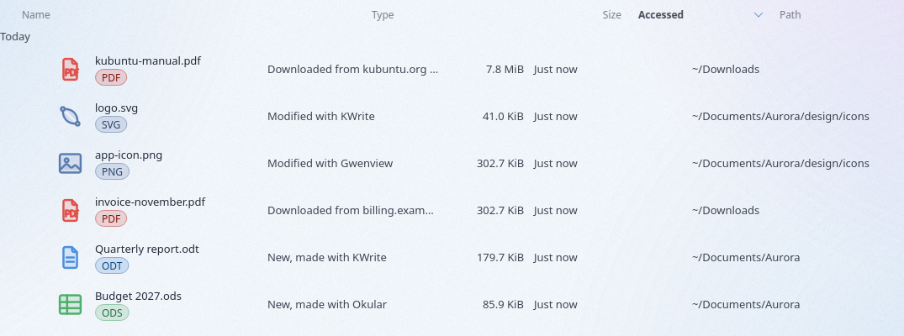
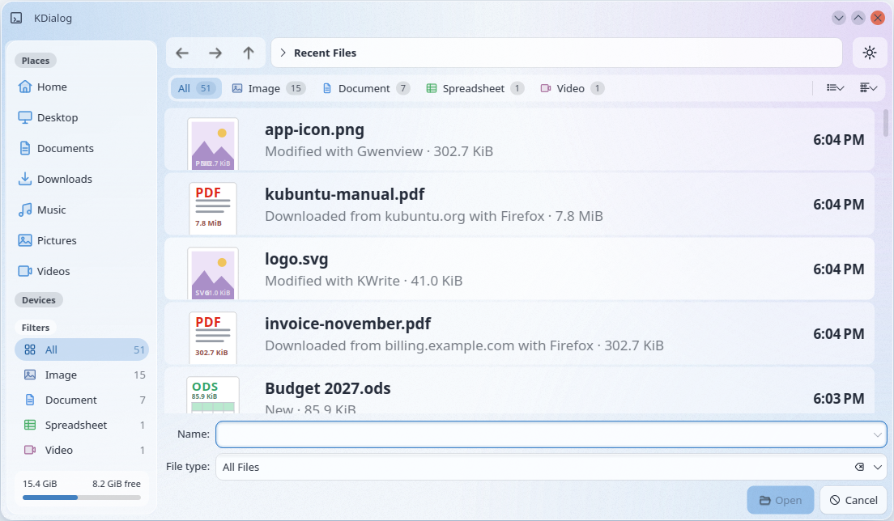
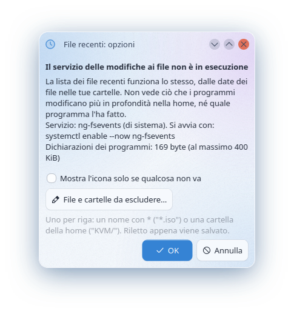

# ng-recent

**Status: an early version**, in daily use by its author. The interface for other programs may still change.

What happened lately to your files and folders, as a list any KDE file view can show: `ngrecent:/`.

KDE's "Recent Files" only knows the files an application opened. A picture just pasted into a folder, a download,
a file another program made, a new folder: none of them is there, so the next "Open" dialog (a browser's upload)
cannot offer them. This list has them. [Dolphin NG](https://github.com/Morzilla/dolphin-ng) and
[Dialog NG](https://github.com/Morzilla/dialog-ng) show it in place of "Recent Files" when it is installed.



It comes in three parts, and only the first is needed:

- **the list** (`ngrecent:/`, a KIO worker): made when asked for, nothing running;
- **`ng-recentd`**, for other programs: it gives them the list and takes what they did to a file (D-Bus, started
  on demand);
- **`ng-recent-status`**, an icon in the system tray that says whether everything behind the list works.

With the [ng-fsevents](https://github.com/Morzilla/ng-fsevents) system service, the list also knows what
programs changed anywhere in the home, and which program it was.

| In Dolphin NG | In every application's Open window (Dialog NG) |
|---|---|
|  |  |

## What it lists

The latest event of each file and folder in the last two weeks, the latest first:

| Event | How it is known |
|---|---|
| New, New folder | the file's dates: made and not changed since |
| Added | made later than its own content: copied or moved here |
| Modified | changed after it was made |
| Downloaded from *site* | the origin browsers write on a download (`user.xdg.origin.url`) |
| *Action*, from *file* | what Dolphin NG writes on the result of a quick action |
| Opened | KDE's and GTK's recent documents (`recently-used.xbel`). Left out unless asked for: `ShowOpened=true` in `~/.config/ng-recent/list.conf`, or the tray icon's options |
| Modified with *GIMP*, Downloaded with *Firefox*, *1,248* new files with *Ark* (one line that opens) | the [ng-fsevents](https://github.com/Morzilla/ng-fsevents) service, where it runs |

It needs nothing running. When the list is asked for it reads the folders people keep their things in (Downloads,
Desktop, Documents, Pictures, Videos, Music, two levels deep, and the home's own files), the desktop's recent
documents, and a journal that programs can add to (`~/.local/share/ng-recent/journal.tsv`).

## Limits

- Only those folders are read: something new elsewhere is listed only if a program wrote it in the journal or an
  application opened it.
- Hidden files and unfinished downloads are left out.
- An entry is the real file: opening, dragging or deleting it acts on the file itself.

## Build

```sh
cmake -B build -DCMAKE_INSTALL_PREFIX=/usr && cmake --build build && sudo cmake --install build
ng-recent-list        # the same list on the terminal
kioclient ls ngrecent:/
```

Needs Qt 6 and KDE Frameworks 6 (KIO, Extra CMake Modules).

## Licence

LGPL-2.1-or-later. The build files are CC0-1.0.

## Things done in one go

Unpacking an archive or a synchronisation changes hundreds of files: as lines of their own they would bury
everything else. ng-fsevents tells which files were changed in one go (by one application, one after the other),
and the list shows such an operation of 4 files or more as **one line that opens like a folder** on its files
(`ngrecent:/op/<id>`): "1,248 new files with Ark". Files changed a few at a time stay lines of their own, and
so do a few files changed at the same moment in different folders: one line is for files that belong together
(all in one folder, or in a folder the operation made, or 20 and more).

## By hand or on its own

ng-fsevents says which changes were made by things that work on their own: a synchronisation, an updater, a
timer (a process in a systemd service), or the desktop's own background programs. They are not in the list,
which is about what you did; they have a list of their own, `ngrecent:/automatic`, where each line names the
program: "Modified, automatic (onedrive)". Dolphin NG shows the two as "Yours" and "Automatic" among the
filters of its sidebar.

## With and without ng-fsevents

The list needs nothing running: it is made from the dates of the files in the user's folders (two levels deep),
what browsers and Dolphin NG write on the files, and the desktop's recent documents.

Where the [ng-fsevents](https://github.com/Morzilla/ng-fsevents) system service runs, it is asked as well (D-Bus,
`org.ng.FsEvents1.Events`). It adds what the dates cannot tell: files changed anywhere in the home, at any depth,
and the program that did it, named as the desktop names the application. When the service is not installed or
does not answer, the list is the one above: nothing to configure either way.

## For other programs: `org.ng.Recent1`

`ng-recentd` gives the same list to any program and takes what programs want to tell, on the session bus
(object `/org/ng/Recent1`). The bus starts it when it is called and it leaves after a minute with nothing to
do. What it is told is written to the journal at once (`~/.local/share/ng-recent/journal.tsv`, at most 400 KiB:
past that the older half goes), so nothing is lost while it, or the file manager, is not running. The list is
never emptied by reading it: every reader gets all of it.

| Member | |
|---|---|
| `Note(s path, s kind, s detail, s source)` | the calling program did something to `path`. `kind`: `created`, `added`, `modified`, `downloaded` (`detail`: the site), `made` (`detail`: what made it, `source`: the file it was made from), `opened`. The caller's application is found out by the service and kept with the note |
| `Events(i days, u limit) → a(sxssssbs)` | the list: path, when (ms), kind, detail, source, application, is a folder, the event in words in the user's language |
| signal `Changed()` | a program told something (only while the service runs) |

```sh
gdbus call --session --dest org.ng.Recent1 --object-path /org/ng/Recent1 \
    --method org.ng.Recent1.Note "$HOME/Videos/talk.mp4" made "Convert to MP4" "$HOME/Videos/talk.mkv"
```

## The icon in the system tray



`ng-recent-status` starts with the Plasma session and says whether everything behind the list works: the
ng-fsevents service runs, it can listen to this home, no changes were lost lately, how much the journals hold.
Without the service the list still works, and the icon says what it then does not see (as in the picture).
Its options can keep it hidden unless something is wrong, and open the list of files and folders the service
leaves out. It is built when KF6StatusNotifierItem is found.
